<p align="center">
  <picture>
    <source media="(prefers-color-scheme: dark)" srcset="assets/brand/markstage-logo-dark.png">
    
  </picture>
</p>

<p align="center">
  <strong>Type it. Ship it.</strong><br>
  The visual editor for Astro sites, with Notion-style blocks. We built it when we moved our own site off WordPress:<br>
  writers change Markdown and JSON content on the site's own design, not in form fields,<br>
  and every save is a clean git diff of exactly what they changed.<br>
  No content database, no subscription. MDX too: code stays locked, prose is editable.<br>
  Source-available and free to self-host.
</p>

<p align="center">
  <a href="LICENSE"></a>
  
  
  <a href="https://github.com/spcaeo/markstage/actions/workflows/ci.yml"></a>
  <a href="CHANGELOG.md"></a>
  
</p>

<p align="center">
  <a href="https://spcaeo.github.io/markstage/demo/"></a>
  <a href="https://spcaeo.github.io/markstage/"></a>
  <a href="#quick-start"></a>
</p>

<p align="center">
  <a href="https://spcaeo.github.io/markstage/"><strong>Website</strong></a> ·
  <a href="https://spcaeo.github.io/markstage/demo/"><strong>Live demo</strong></a> ·
  <a href="#quick-start"><strong>Quick start</strong></a> ·
  <a href="#writes-like-notion">Writes like Notion</a> ·
  <a href="#ai-and-mcp">AI and MCP</a> ·
  <a href="#features">Features</a> ·
  <a href="#whats-new">What's new</a> ·
  <a href="#see-it">Screenshots</a> ·
  <a href="#how-markstage-compares">Comparison</a> ·
  <a href="docs/WRITING.md">Writer's guide</a> ·
  <a href="docs/DEPLOY.md">Deploy guide</a> ·
  <a href="SECURITY.md">Security</a> ·
  <a href="#faq">FAQ</a> ·
  <a href="#commercial-licence">Commercial licence</a>
</p>

<p align="center">
  <picture>
    <source media="(prefers-color-scheme: dark)" srcset="docs/screenshots/hero-dark.png">
    <source media="(prefers-color-scheme: light)" srcset="docs/screenshots/hero.png">
    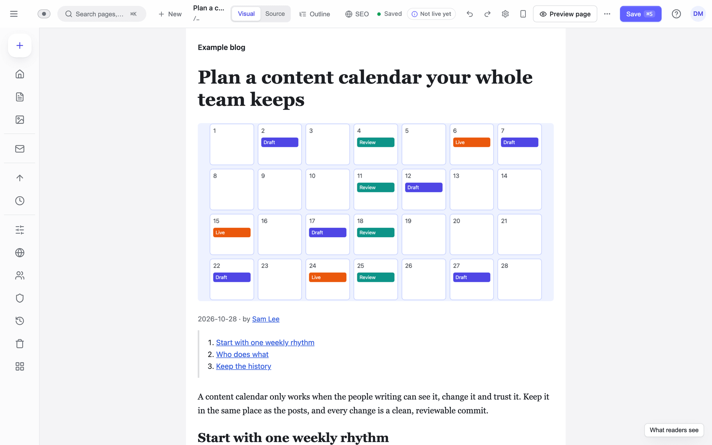
  </picture>
</p>

## Writes like Notion

The block editor people already know, drawn on your real design instead of grey form fields.

<p align="center">
  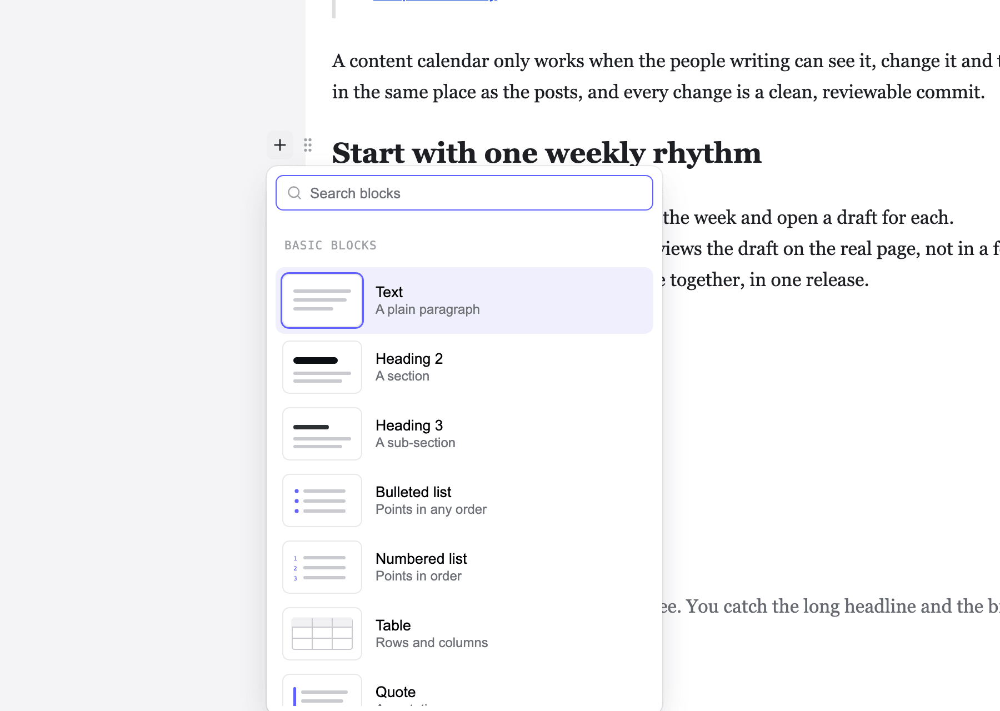
</p>

- **Type "/" for any block.** On an empty line, "/" opens a searchable block menu with a small drawing of each
  block. Or click the "+" beside a line.
- **Drag blocks by their grip.** Drag a block, or open its menu: move it up, down, to the top, to the bottom or to
  a place you pick, duplicate it or delete it.
- **Find anything with ⌘K.** One search box for pages, posts, the editor's screens and its settings.
- **Paste from Word.** Word's headings and lists arrive as real blocks, without its office markup.
- **An outline of the page.** Every block under its heading: jump to one, fold a section, drag rows to move them.
- **Never lose typing.** A crash or a closed tab brings your words back; history keeps every saved version.

## AI and MCP

AI that drafts, people who publish. Both ship today and come with the free self-hosted server; the suggestions use
your own AI key.

- **An MCP server.** Claude or any MCP client reads the site and drafts changes as the person whose token it holds:
  the same role, locks and checks. It never deletes, moves or promotes anything, and by default it never publishes;
  changes to live pages go into a release a person reviews. Local clients connect through the `markstage mcp` relay
  ([docs/API-MCP.md](docs/API-MCP.md)).
- **An MCP publish tool, only when you allow it.** An owner or administrator may give an agent a token with
  `mcp:publish` (the Tokens screen warns plainly). The agent may then ask to publish a release: the site's checks
  run first and a failed one stops it, then the publish rules and roles decide as they would for that person. Every
  such publish is audited and its commit names the agent and the person; at most 5 an hour per token.
- **AI suggestions in the editor.** Alt text, a search title and description, a translation draft, and a summary
  of a promotion, each next to the value it is for. Nothing changes until a person accepts it
  ([docs/API-AI.md](docs/API-AI.md)).
- **Writing help on the page.** Select a few words, then "Improve with AI" in the format bar: Rewrite, Shorten, Fix
  spelling and grammar, or Change tone (friendly, formal, confident). The suggestion shows beside the words as a
  diff; accept, edit or reject it. Accepting is one change you can undo, and nothing saves by itself.
- **Your choice of model.** Anthropic (the default), any OpenAI-compatible endpoint (OpenAI, Azure OpenAI,
  OpenRouter, Together, LM Studio) or Ollama on your own machine, with no key. An owner can check the connection
  and that the model is there ([docs/API-AI.md](docs/API-AI.md), "Providers").
- **Coming next:** see the AI items on the [roadmap](#roadmap) and on
  [the AI page](https://spcaeo.github.io/markstage/ai/).

## Inspired by Ghost and Prismic

- **Ghost's calm writing, on your own design.** We studied Ghost's editor row by row and kept what writers love:
  alt text and captions right on the image, stock photos from Unsplash or Pexels with your own key, and a publish
  sheet that checks links, alt text and the page on a phone before it goes live.
- **Prismic's page building, without the bill.** We used Prismic and left over its price and the missing path from
  development to live. Markstage includes a Library of reusable sections, local, staging and production, releases
  with share links, custom roles and an "Edit this page" link on the live site, free to self-host. What Prismic
  charges for each is in [the comparison](docs/COMPARISON.md).

## Why we built it

In October 2026, Space-O Technologies moved its own site, taskrhino.ca, off WordPress to a fast, static Astro
site. Our writers still needed to change pages on the real design, without a content database, a subscription or
MDX, and from our own server. We compared 21 other editors: none of them lets writers edit on the real page from
your own server with no database server ([the comparison](https://spcaeo.github.io/markstage/compare/)). So we
built Markstage, and now give it away to self-host. The whole story:
[Why we built Markstage](https://spcaeo.github.io/markstage/why/).

## Built with Markstage: taskrhino.ca

<p align="center">
  <a href="https://spcaeo.github.io/markstage/showcase/">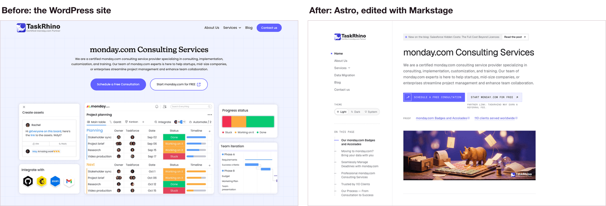</a>
</p>

[taskrhino.ca](https://www.taskrhino.ca/) moved 158 posts, 20 pages and 2,414 images and files from WordPress,
with every address kept. On a phone its home page went from a Lighthouse speed score of 71 to 99 (measured on 28 and
29 October 2026, the new site from its build before launch). Its writers now edit it with Markstage.
[See the before and after](https://spcaeo.github.io/markstage/showcase/).

---

## What's new

- **0.3.0: the first public release, with a security review and two quality passes** ([changelog](CHANGELOG.md#030-3-november-2026)).
  A link to `javascript:` is refused for every role, the preview page can no longer press Save, sign-in lockouts
  hold the account and the address together, and a title over 300 characters is refused with a plain message
  instead of being cut. CI now runs every check, every package's tests, the browser tests, a dependency audit and a
  secrets scan on each push.
- **0.2.0: the first numbered release** ([changelog](CHANGELOG.md#020-2-november-2026)).
  Writing on the real page, the Library of templates, sections and snippets, a secure server with roles and single
  sign-on, releases and scheduled publishing, staging next to production, forms with an inbox, and the site
  check-up. Packages `@markstage/core`, `editor`, `astro` and `server`, a Docker recipe and an example blog.

Every change: [CHANGELOG.md](CHANGELOG.md).

## Astro has content collections, but no editor your writers can use

Astro's content collections give your Markdown, MDX, YAML and JSON files a schema and type safety. They do not
give you an editing screen. Astro's own docs describe a CMS as a separate tool that "lets you write content and
manage assets outside of your Astro project", and send you to a list of them.

So the writers on an Astro site usually get one of three things:

| What they get | What it costs them |
| --- | --- |
| **Markdown in a code editor**, through git | A developer for every typo; no picture of the page while writing. |
| **A form-based git CMS** (fields beside, or above, a preview) | They fill in boxes and guess how the page will look. |
| **A hosted headless CMS** | The content moves out of your repo into someone else's database, behind an API and a monthly plan. |

Markstage is the fourth way. The writer edits **on the page itself**: the site's own components, CSS and column
width, drawn by your Astro project. The content stays **Markdown and JSON files in your git repo**, and a save
rewrites **only the blocks that changed**, so a review shows exactly what moved. Your production build is byte for
byte the same with or without Markstage, and can stay fully static.

## Why Markstage

<table>
<tr>
<td width="50%" valign="top">

### Write on the real page
Each entry is drawn inside its real page, with the site's components and CSS, so a writer sees what a reader will
see. Text, images, tables and links are changed where they appear; alt text, captions and link targets are edited
in place. JSON pages are edited on the rendered page too, with each section's fields in a side panel.

</td>
<td width="50%" valign="top">

### A save is a surgical diff
Open and save with no edit, and the file is byte for byte the same. Move a block and move it back, and it is
byte-identical again. Only the changed blocks are rewritten; front matter keeps its key order and quoting. With the
Markstage server, every save is a git commit in the writer's own name.

</td>
</tr>
<tr>
<td valign="top">

### Never lose typing
Local recovery copies in the browser, retry while offline, a three-way merge when two people edit the same entry,
and "Sign in again" that keeps the text. When someone else saves the page, a banner says so at once.

</td>
<td valign="top">

### Your content stays yours
No content database and no content API: posts are Markdown files, pages are JSON files, in your repo. One SQLite
file on the server (the SQLite built into Node) holds people, sessions, the inbox, drafts in progress, trash,
releases, the media index and the audit log. No database server, and no Markstage cloud.

</td>
</tr>
<tr>
<td valign="top">

### A team's workflow, included
Roles and custom roles, invitations, two-factor sign-in and single sign-on with any OpenID Connect provider.
Drafts, scheduling, releases that put several changes live together, share links for previews, and rollback.
Staging next to production, with promotion plans and rules about who may promote.

</td>
<td valign="top">

### Run the site from the editor
Media library, menus, redirects, find and replace, bulk changes, trash, locks, backups, authors, page types,
translations status, and a site check-up: SEO checks while writing, publish rules, internal links and a topic map,
broken links, and what the host serves for every address.

</td>
</tr>
<tr>
<td valign="top">

### Forms land in your own inbox
The site's forms post to Markstage on your own host. Messages go to the Inbox with spam checks, alerts and a daily
digest, and can be sent on to Odoo as leads or to Skald analytics. Nothing goes through a third-party form service.

</td>
<td valign="top">

### AI that drafts, people who publish
An MCP server lets an AI agent read the site and draft changes as the person whose token it holds. It never
publishes, deletes or promotes anything: changes to live pages go into a release a person reviews. With your own
key, AI suggestions for alt text, search titles and translations, which nobody saves without reading.

</td>
</tr>
</table>

## Features

Every feature, grouped as on [the features page](https://spcaeo.github.io/markstage/features/), where each one
links to the doc that explains it. Every operational task end to end: [docs/OPERATIONS.md](docs/OPERATIONS.md).

- **Writing** (12, [on the site](https://spcaeo.github.io/markstage/features/#writing)): Type “/” for any block; Drag blocks by their grip; Find anything with ⌘K; A bar over selected words; Markdown shortcuts as you type; Paste from Word, cleanly; Tables you change in place; The outline of the page; Find and replace; MDX too; The Markdown file itself; A guide inside the editor.
- **Pages, sections and media** (12, [on the site](https://spcaeo.github.io/markstage/features/#pages)): Edit on the real page; Your site’s own boxes; A Library of parts; Drag a section onto the live page; The section gallery; Alt text right on the image; Images and files in one place; Stock photos, with your own key; Page frames and page types; Authors and co-authors; Translation status; Choices from other systems.
- **Team, releases and publishing** (13, [on the site](https://spcaeo.github.io/markstage/features/#team)): A publish sheet that checks; Releases; Share links; Local, staging, production; “Edit this page” on the live site; Every save is a commit in your name; Roles, as WordPress names them; Custom roles; Single sign-on and two-factor; Locks; See who else is editing; Forms in your own inbox; Webhooks and imports.
- **SEO and site health** (8, [on the site](https://spcaeo.github.io/markstage/features/#seo)): Search checks while you write; Search and social previews; See it on a phone or a tablet; Link suggestions both ways; Link health; Topics and a topic map; Redirects that follow a move; Site check-up.
- **Safety and history** (7, [on the site](https://spcaeo.github.io/markstage/features/#safety)): A save is a clean diff; Never lose typing; A three-way merge; History of every save; Trash, backups and rollback; An audit log; Previews kept apart.
- **AI and MCP** (12, [on the site](https://spcaeo.github.io/markstage/features/#ai)): An MCP server for AI agents; The markstage mcp relay; Publishing by an agent, only if you allow it; Writing help on a selection; Alt text suggestions; Search title and description; Link suggestions to your own pages; Fixes for search problems; Translation drafts; Translate the whole site; A promotion summary; Your choice of AI provider.

## See it

Every image below is the real editor on the repo's example blog, with made-up people and `example.com`
addresses. `npm run site:shots` takes them again from the code.

**Try it yourself:** the [live demo](https://spcaeo.github.io/markstage/demo/) is the real editor on the same example blog, in your browser with no
sign-up. Edit a post on its page and press Save to see the git diff the save would commit; your edits stay in
your browser. Publishing, users and settings answer "Not in the demo" there ([how the demo works](docs/DEMO.md)).

<p align="center">
  <a href="https://spcaeo.github.io/markstage/demo/"></a><br>
  <strong>The live demo.</strong> Open a post, change a heading, press Save: the diff is that one line.
</p>

<p align="center">
  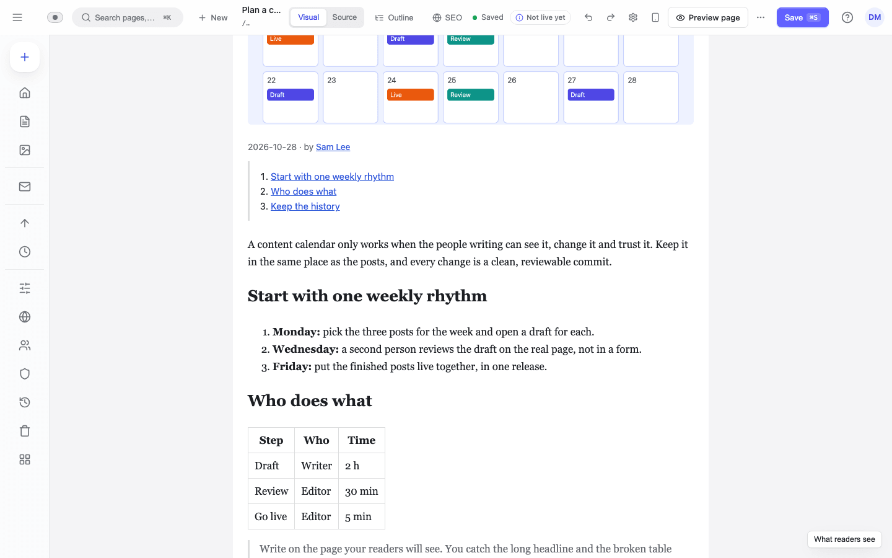<br>
  <strong>The canvas is the page.</strong> Headings, lists and tables in the site's own type and column, edited where they are.
</p>

| | |
| :---: | :---: |
| 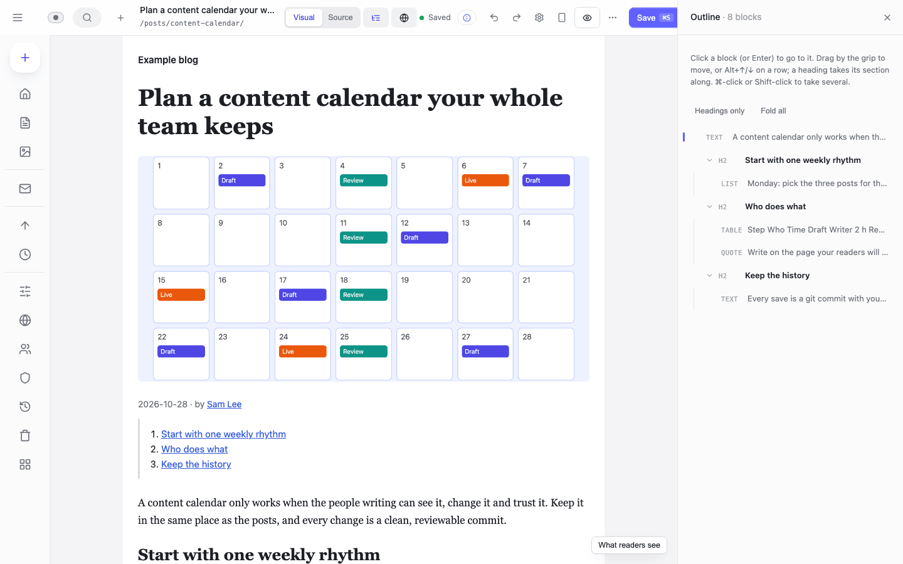<br>**Outline.** Every block, to find it or move it. | 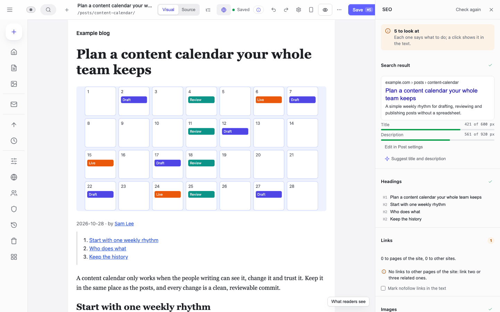<br>**SEO while writing.** The search result in pixels, headings, links. |
| 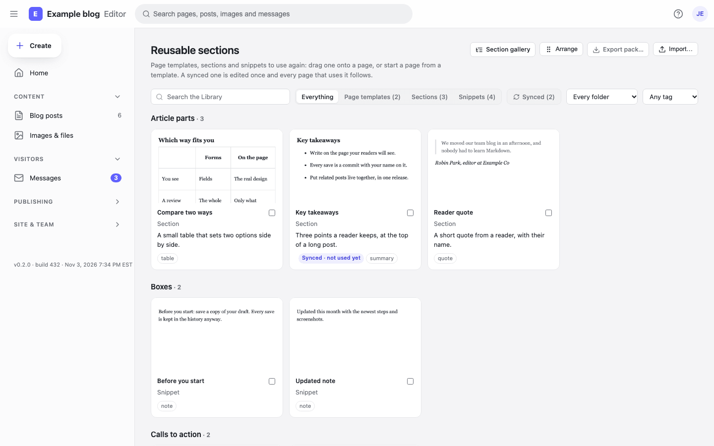<br>**The Library.** Templates, sections and snippets, each drawn as it looks. | 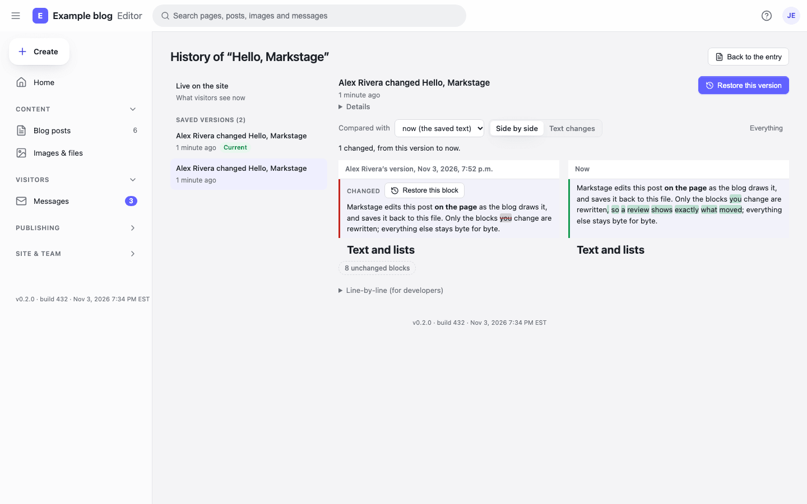<br>**History.** Every save, compared side by side, restored by block or whole. |
| 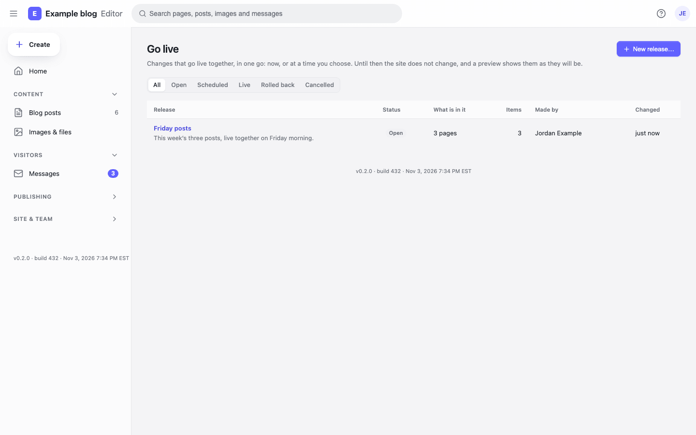<br>**Releases.** Several changes live together, now or later. | 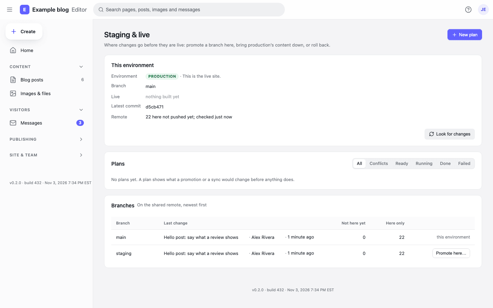<br>**Staging and live.** Branches, plans and promotion. |
| 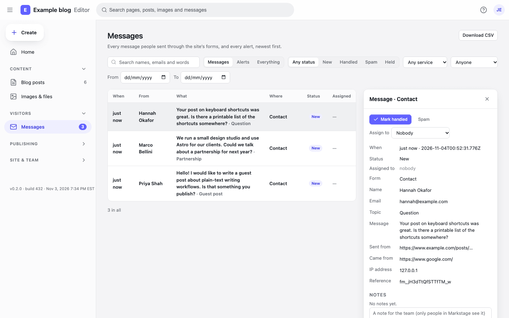<br>**Messages.** The site's forms, in your own inbox. | 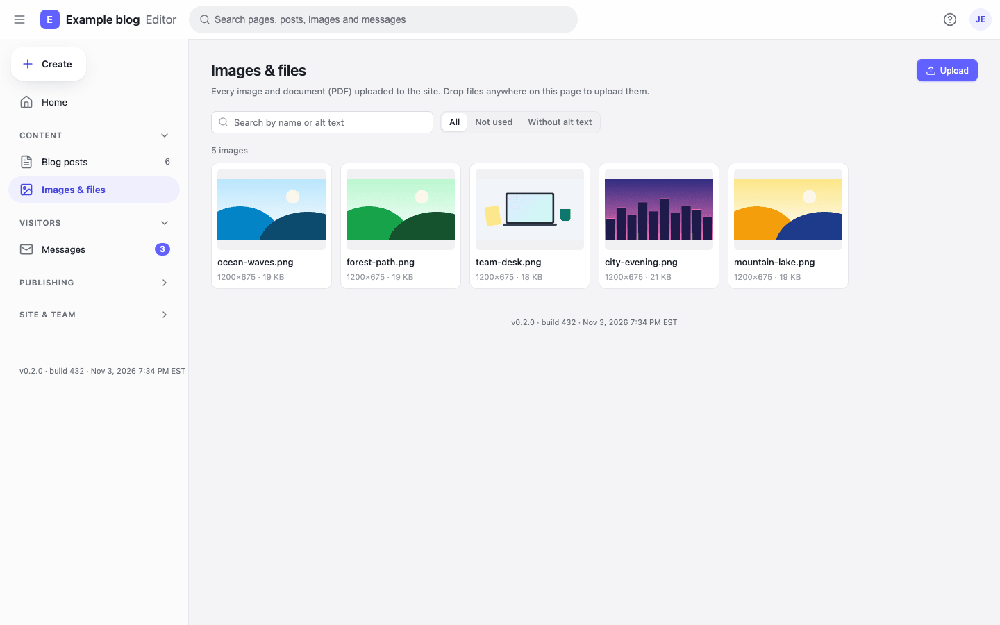<br>**Images and files.** Find, reuse, and spot missing alt text. |
| 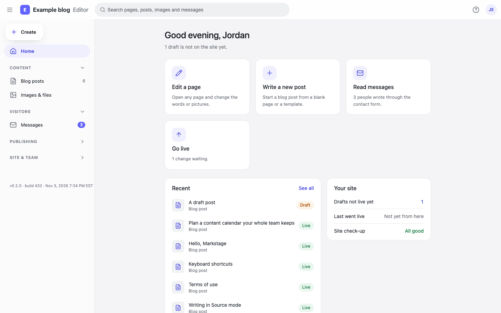<br>**Home.** What waits for you, in plain words. | 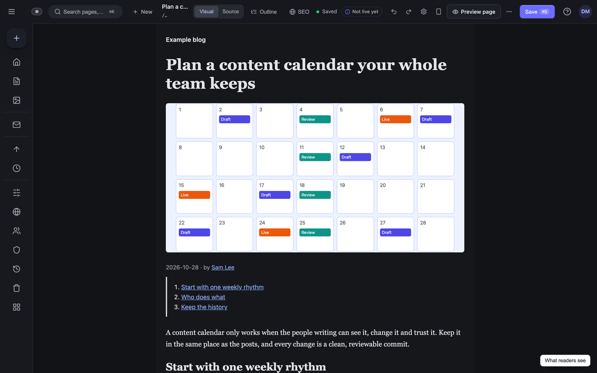<br>**Dark theme.** The editor, and the site in its own dark colours. |

## Quick start

You need **Node.js 22.13 or newer** and **git**; to add it to your own site, the site needs **Astro 7.4 or newer**.
**Not on npm yet: install from a clone.** The `@markstage/*` packages are not published to npm, so each way below
starts from a clone of this repository.

**Just looking?** The [live demo](https://spcaeo.github.io/markstage/demo/) runs the editor on the example blog in your browser, nothing to install.

### Option 0: start a new site from the starter

Not one command yet (the packages are not on npm), but three:

```sh
git clone https://github.com/spcaeo/markstage.git
node markstage/scripts/create-site.mjs my-blog
cd my-blog && npm run dev
```

Open **http://127.0.0.1:18237/markstage/**. The new folder is a small Astro blog with Markstage set up: Markdown
posts, an MDX guide, a light and dark look, and its own git repository. The script copies `examples/starter`, puts
this clone's packages in the site's `vendor/` folder, installs and commits. Step by step:
[docs/STARTER.md](docs/STARTER.md).

### Option 1: try the example blog (one minute)

```sh
git clone https://github.com/spcaeo/markstage.git
cd markstage && npm install
npm run dev -w examples/blog
```

Open **http://127.0.0.1:18233/markstage/**. This is `astro dev` with the editor in it: no sign-in, on
`127.0.0.1` only. Saves go to the Markdown files in `examples/blog/src/content/posts/`, so `git diff` shows exactly
what you changed. The writer's side is explained in [docs/WRITING.md](docs/WRITING.md).

### Option 2: add it to your Astro site

With the clone next to your site's folder, link the packages, add the integration and describe your content:

```sh
# in your site's folder, beside ../markstage
npm install ../markstage/packages/core ../markstage/packages/editor ../markstage/packages/astro
```

```js
// astro.config.mjs
import { defineConfig } from 'astro/config';
import markstage from '@markstage/astro';

export default defineConfig({
  integrations: [markstage()],
});
```

```js
// markstage.config.mjs, at the project root
import { defineConfig } from '@markstage/astro';

export default defineConfig({
  siteName: 'My blog',
  collections: [{ id: 'posts', format: 'md', dir: 'src/content/blog', url: '/blog/{id}/' }],
});
```

Run `npx astro dev` and open `/markstage/` on your dev server. Every key (drafts, settings fields, page types,
locales, forms, the editor's CSS and canvas): [docs/CONFIG.md](docs/CONFIG.md).

### Option 3: run the server for your team

The Markstage server adds sign-in, roles, the Library, releases, environments, forms and history, and builds and
deploys your static site. It runs next to the site on your own server. With Docker, it is one `docker run` from the
folder that holds your site's git repository (`my-blog`, from Option 0 or your own):

```sh
docker run -d --name markstage -p 127.0.0.1:18231:18231 \
  -v "$PWD/my-blog:/srv/content" -v markstage-modules:/srv/content/node_modules \
  -v markstage-data:/srv/data -v markstage-site:/srv/site \
  ghcr.io/spcaeo/markstage:latest
docker exec markstage markstage-server setup-code
```

Then open `http://127.0.0.1:18231/markstage/#/setup`, enter the one-time code and make the owner. There is no
default password: the first owner needs that code. On its first start the image writes a config, installs the
site's packages and builds its editor; **Publish site** then builds and deploys the site inside the container. The
image is published to the GitHub Container Registry with each release (amd64 and arm64); to run your own changes,
build it from the clone with `docker build -f deploy/Dockerfile -t markstage-server .` and use that name. CI builds
and smoke-tests it on every push. Settings, secrets, compose with nginx and updates: **[docs/DOCKER.md](docs/DOCKER.md)**;
HTTPS in front, previews, backups and the systemd way without Docker: **[docs/DEPLOY.md](docs/DEPLOY.md)**.

## Integrations

Only what the code has today, each with its own doc.

- **Astro.** `@markstage/astro`: the editor inside `astro dev`, `markstage build-editor` for the server, and helpers
  for field bindings, authors, page frames and topics ([docs/CONFIG.md](docs/CONFIG.md)).
- **Single sign-on.** Any OpenID Connect provider, beside email and password with two-factor codes
  ([docs/API-SSO.md](docs/API-SSO.md)).
- **Forms to a CRM and to analytics.** A form can send each real message to **Odoo** as a lead (over XML-RPC) and to
  **Skald** analytics as a signed lead; spam never goes, and failed sends are retried and shown in the Inbox
  ([docs/API-INBOX.md](docs/API-INBOX.md)).
- **Alerts.** Email, **Slack** or a webhook, per kind of alert, with a daily digest; safety alerts always go by mail
  ([docs/API-INBOX.md](docs/API-INBOX.md)).
- **Webhooks.** Signed with HMAC-SHA256, tried again five times, the last about nine hours after the first, logged for 30 days, sent only
  to public HTTPS addresses, never with a page's text or a person's email
  ([docs/API-WEBHOOKS.md](docs/API-WEBHOOKS.md)).
- **AI agents (MCP).** A Model Context Protocol endpoint with read tools and, for a draft token, `create_draft`,
  `update_entry` and `add_to_release`; the relay `markstage mcp` connects a local client
  ([docs/API-MCP.md](docs/API-MCP.md)).
- **AI suggestions.** Alt text, search titles and descriptions, a promotion plan's summary and translation drafts from
  Anthropic's Messages API, with your own key in the server's environment; a suggestion never saves itself
  ([docs/API-AI.md](docs/API-AI.md)).
- **Imports.** A whole site from WordPress (an export or the REST API), Ghost (an export or the Content API) or
  Prismic: posts, pages, images, authors, categories and tags, search fields and the old addresses as redirects,
  with a dry run first and every item as a draft ([docs/IMPORT.md](docs/IMPORT.md)). Entries and media as JSON,
  planned first and idempotent on the source's ids ([docs/API-IMPORT.md](docs/API-IMPORT.md)); WordPress reusable
  blocks into the Library ([docs/API-LIBRARY.md](docs/API-LIBRARY.md)).
- **Integration fields.** A settings field whose options come from any JSON address, fetched on a schedule by the
  server ([docs/API-INTEGRATIONS.md](docs/API-INTEGRATIONS.md)).

## How Markstage compares

WordPress, Ghost and Prismic come first: they are the three people weigh most often. Facts about other products
come from each vendor's own website, pricing page, docs or code repository, checked on 2026-11-03 (Ghost's on
2026-11-04). The full matrix, with a source for every cell and 13 more products (Sveltia CMS, Pages CMS, Front
Matter CMS, Outstatic, Sitepins, EmDash, StudioCMS, Sanity, Contentful, Builder.io, Payload, Strapi and Statamic),
is in **[docs/COMPARISON.md](docs/COMPARISON.md)**.

✓ yes · ◐ partly, or on some plans · ✗ no, or not found in its docs · ? not confirmed on the vendor's pages

|                                 |   **Markstage**    |       WordPress       |      Ghost      |       Prismic        |       TinaCMS        |   CloudCannon    |      Decap CMS       |    Keystatic    |     Storyblok     |
| ------------------------------- | :----------------: | :-------------------: | :-------------: | :------------------: | :------------------: | :--------------: | :------------------: | :-------------: | :---------------: |
| **Editing**                     |                    |                       |                 |                      |                      |                  |                      |                 |                   |
| Edits on the site's own design  |         ✓          |      ✗ headless       |   ✗ headless    |    ◐ live preview    |          ✓           |        ✓         |    ◐ preview pane    |        ✗        |         ✓         |
| MDX                             |         ◐          |           –           |        –        |          –           |          ✓           |        ?         |          ?           |        ✓        |         –         |
| **Content and git**             |                    |                       |                 |                      |                      |                  |                      |                 |                   |
| Content as files in git         |         ✓          |           ✗           |        ✗        |          ✗           |          ✓           |        ✓         |          ✓           |        ✓        |         ✗         |
| Database to run                 | None for content ¹ |   MySQL or MariaDB    |     MySQL 8     |        Hosted        |  ◐ when self-hosted  |      Hosted      |         None         |      None       |      Hosted       |
| Live Astro site can stay static |         ✓          |           ?           |        ?        |          ?           |   ◐ needs islands    |        ✓         |          ◐           | ◐ admin routes  |         ◐         |
| **Team and workflow**           |                    |                       |                 |                      |                      |                  |                      |                 |                   |
| Roles and custom roles          |     ✓ included     |      ✓ six roles      |  ✓ five roles   | ◐ custom: Enterprise | ◐ custom: Enterprise |  ◐ custom: Team  |   ◐ custom: add-on   |        ✗        | ◐ custom: Premium |
| Single sign-on                  |  ✓ OpenID Connect  |           ?           |  ◐ Custom plan  |     ◐ Enterprise     |     ◐ Enterprise     |   ◐ Enterprise   |          ✗           |        ✗        |     ◐ Premium     |
| Staging and production          |     ✓ included     |           ?           |        ?        |  ◐ Platinum add-on   |      ◐ branches      |   ◐ Team plan    | ◐ editorial workflow |        ?        |     ◐ Premium     |
| Forms inbox                     |         ✓          |           ?           |        ?        |          ✗           |          ✗           |        ✓         |          ✗           |        ✗        |         ✗         |
| **Hosting and price**           |                    |                       |                 |                      |                      |                  |                      |                 |                   |
| Self-host                       |         ✓          |           ✓           |        ✓        |          ✗           |          ✓           |        ✗         |          ✓           |        ✓        |         ✗         |
| Hosted plan                     |         ✗          |           ?           |  ✓ Ghost(Pro)   |          ✓           |          ✓           |        ✓         |       ◐ Turbo        |     ◐ Cloud     |         ✓         |
| Price to start (monthly)        | Free to self-host  | Free; you pay hosting | Free; Pro $18 ⁴ | Free; Starter $10 ²  |    Free; Team $29    | $55 ($49 yearly) |   Free; Turbo €19    | Free; Cloud $10 | Free; Growth $99  |
| Licence                         | Source-available ³ |    GPLv2 or later     | OSI, permissive |        Closed        |      Apache 2.0      |      Closed      |   OSI, permissive    | OSI, permissive |      Closed       |

¹ Content lives in git. One SQLite file holds people, sessions, the inbox, drafts in progress, trash, releases, the
media index and the audit log, so there is no database server to run. ² Per repository, paid yearly. ³ Elastic License 2.0: free to use and self-host, including for
clients; not to be offered to others as a hosted service. ⁴ Ghost(Pro) Starter, billed monthly ($15 a month billed
yearly); Ghost itself is free to self-host. Prices are list prices on 2026-11-03 (Ghost's on 2026-11-04) and change
often.

**WordPress and Ghost** are mature publishing platforms with large communities. With Astro, both are used headless:
writers work in their own admin and Astro reads the content by API. Ghost also has newsletters, memberships and
paid subscriptions built in, which Markstage does not. **Prismic** is a hosted page builder: nothing to run, and
your developers build the sections. Markstage differs from all three in where writers work (on the Astro site's
own design) and where content lives (files in your git repository).

Astro gives content collections (Markdown, MDX, JSON and YAML with a schema) but no editor of its own; its docs
send you to a CMS. Markstage is that editor for teams who want writers to work on the site's real design, every
save to change only what was edited (with the Markstage server, a commit by the person who saved), and staging, roles, single sign-on and a forms inbox included, all on
their own server for free. CloudCannon is the closest hosted product: also git-based, with editing on a preview of
the built site, from $55 a month. TinaCMS gives click-to-edit on Astro pages and has edited MDX for longer;
Markstage's MDX support is new. Decap CMS needs no server at all and Keystatic runs inside your Astro site, but with both, writers fill in
forms rather than editing the page itself. Markstage is pre-release; most products here have years of use and bigger communities.

### Where others lead (honestly)

- **MDX.** Markstage edits MDX files' words and simple component settings and keeps the code as written, but it
  shows components as cards, not rendered, and its MDX support is new ([docs/MDX.md](docs/MDX.md)). TinaCMS,
  Keystatic and Outstatic have edited MDX for longer.
- **No server at all.** Decap CMS and Sveltia CMS run in the browser against your git host. Markstage needs Node.js
  for a team (sign-in, publishing, the inbox); alone on your computer it runs inside `astro dev`.
- **A hosted service.** Prismic, Ghost(Pro), CloudCannon, TinaCloud and Storyblok run it for you. Markstage is
  self-hosted only.
- **Publishing and memberships.** Ghost has newsletters and paid subscriptions built in; WordPress has a very large
  ecosystem of themes and plugins.
- **Years of use.** Most of these products have been in production for years, with bigger communities and plugin
  ecosystems. Markstage is pre-release.
- **Frameworks other than Astro.** Markstage's core has no framework in it, but it has one adapter so far, Astro; more are planned (see the Roadmap).

The same comparison on the website, with one page per alternative:
[spcaeo.github.io/markstage/compare/full/](https://spcaeo.github.io/markstage/compare/full/).

## Who it is for

- **Writers and editors** who want to write on the page readers will see, in plain words, with no Markdown to
  learn and a guide inside the editor.
- **Developers and agencies** who keep Astro, their components and their git workflow, and want to give clients a
  real editor without a hosted CMS or a content database.
- **SEO and content teams** who want search checks, internal link suggestions, page types, redirects and site health
  on every page before it goes live.
- **Organisations with rules** about where content and personal data live: everything runs on your own server, and
  [docs/SECURITY.md](docs/SECURITY.md) lists what is kept, for GDPR and PIPEDA.

## Tech stack

| Layer | What it uses |
| --- | --- |
| Runtime | **Node.js 22.13+** (CI runs every test on Node 24, and the core, Astro integration and server unit tests on Node 22.13 as well). The server's own data (people, sessions, the inbox, drafts in progress, releases, the audit log) is in `node:sqlite`, built into Node: no database server. |
| Core (`@markstage/core`) | Pure Node and browser code, no framework: the Markdown ⇄ document converter (unified, remark-parse, remark-gfm) with block packs, surgical saves, and front matter edited in place (yaml). |
| Editor (`@markstage/editor`) | **TipTap 3** on ProseMirror and **CodeMirror 6**, in vanilla TypeScript; no UI framework. |
| Astro (`@markstage/astro`) | An Astro integration: the editor and a dev API inside `astro dev` (127.0.0.1 only), `markstage build-editor` for production. |
| Server (`@markstage/server`) | Node's own `http`, no web framework; one runtime dependency (`@markstage/core`), and `sharp` (optional) to re-encode images. |
| Content | Your site's Markdown and JSON files; every save and publish is a git commit. |
| Deploy | A server image (built and smoke-tested by CI, published to the GitHub Container Registry with each release), a compose file, nginx recipes, systemd, and `markstage-deploy`, which switches releases atomically and rolls back. A starter site to begin from. |
| Security | scrypt password hashes, TOTP two-factor codes, HttpOnly + Secure + SameSite=Strict sessions, CSRF tokens, a strict CSP. |
| Tests | `node:test` in every package, Playwright browser tests for the server and editor, a dependency audit and a gitleaks secrets scan in CI. |

## Architecture

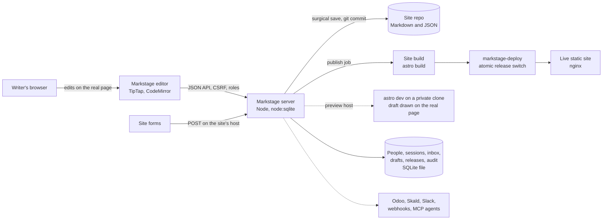

- **Two modes, one editor.** In `astro dev` the editor runs inside your dev server with no sign-in, bound to
  `127.0.0.1`, and saves straight to the files. On a server, the same editor talks to the Markstage server, which
  signs people in and publishes.
- **The canvas is your page.** Components emit field bindings (`data-ms-field`) only in editor mode, so the
  production build never changes. Previews of drafts run on their own host name, away from the CMS session.
- **Publishing is a job.** Commit, build, deploy; any failed step reverts the commit and leaves the live release
  untouched, and the writer's text is kept.

More: [docs/ARCHITECTURE.md](docs/ARCHITECTURE.md), [docs/API.md](docs/API.md) and
[docs/CANVAS-FIDELITY.md](docs/CANVAS-FIDELITY.md).

## Security and privacy

- **No default password.** A fresh server has no users; the first owner needs a one-time code from
  `markstage-server setup-code`, valid for an hour and once.
- **Hardened sign-in.** scrypt hashes, a password policy, rate limits, a lockout per account and address (so a
  stranger cannot lock you out), TOTP two-factor codes with recovery codes, and sessions rotated at sign-in.
- **Enforced on the server.** Every rule the screens show (roles, locks, publish checks) is refused by the server
  too. Raw HTML goes through the editor's sanitiser, and a Contributor cannot save it.
- **Separate origins.** The editor, the previews and share links each have their own host name, so a page's own
  scripts never run where the CMS session lives.
- **Uploads checked.** Types sniffed, sizes limited, SVG refused, images re-encoded.
- **Fetching guarded.** Imports, webhooks and integration fields reach public addresses only, checked after DNS.
- **Secrets stay out.** Keys come from the environment or files outside the repo, are never written to the repo,
  logs or audit, and are replaced by `[hidden]` in any answer.
- **Personal data.** What Markstage keeps about people, and for how long, is listed for GDPR and PIPEDA in
  [docs/SECURITY.md](docs/SECURITY.md), with every control and the test that proves it.

Found a problem? Please do not open a public issue: use **Report a vulnerability** on the Security tab, or write to
**rp@spaceo.ca**. Details and response times: [SECURITY.md](SECURITY.md).

## FAQ

**Is Markstage free?**
Yes, to self-host. You may use, copy, change and run it for free, in your business and for your clients' sites.
There are no per-user, per-site or per-language fees. The one thing you may not do without a commercial licence is
offer Markstage to others as a hosted or managed service.

**Is Markstage free software under an OSI licence?**
No. Markstage is source-available under the [Elastic License 2.0](LICENSE): the code is public, and you may run and
change it for free, with the one limit above. Because of that limit it is not open source in the OSI sense, and we
never call it that.

**How is Markstage different from a headless CMS?**
A headless CMS keeps your content in its own database, usually hosted, and your site reads it through an API.
Markstage keeps content as Markdown and JSON files in your git repository, and the Astro site reads them like any
other files. There is no content database and no content API to depend on.

**How is it different from other git-based editors?**
Most git-based editors (Decap CMS, Sveltia CMS, Keystatic, Pages CMS) show a form, sometimes beside a preview.
Markstage edits on the page. CloudCannon and TinaCMS also edit on the page: CloudCannon is a hosted service, and
TinaCMS can be hosted or self-hosted. Markstage also includes staging, roles, single sign-on and a forms inbox at
no cost.

**Do I need a database?**
Not for content: that stays as files in git. One SQLite file on the server (the SQLite built into Node) holds
people, sessions, the inbox, drafts in progress, trash, releases, the media index and the audit log. There is no
database server to install.

**Does my Astro site have to use server rendering?**
No. Markstage's editing markup appears only in editor mode, so your production build stays exactly as it is and
can stay fully static.

**Does Markstage support MDX?**
Yes, new after 0.3.0. MDX too: code stays locked, prose is editable. Writers change the words and a
component's simple settings (text, numbers, on/off) in the side panel; imports, exports, `{expressions}` and code
props are kept as written, and components show as cards on the canvas. A file Markstage cannot read opens
read-only in Source mode. Details: [docs/MDX.md](docs/MDX.md).

**Can people without a GitHub account edit?**
Yes. People sign in to Markstage with an email and password, with optional two-step sign-in, or through your
single sign-on provider (OpenID Connect). Each save is still a git commit in their own name.

**Is Markstage ready for production?**
Markstage is pre-release and in active development. It is built and tested against a real 460-page Astro site, but
most other products in this space have years of production use. Check the changelog and try it on a copy of your
site first.

More answers: [the FAQ on the website](https://spcaeo.github.io/markstage/faq/).

## Roadmap

Markstage is **pre-release** (0.x): a minor version may still change how things work. The list is kept in
[site-content/roadmap.md](site-content/roadmap.md), which also makes the site's
[roadmap page](https://spcaeo.github.io/markstage/roadmap/) and the "Coming in" badges on the comparison.
No dates beyond "the next release" and "later".

AI that ships today: an MCP server, so an AI agent drafts as the person whose token it holds and publishes only
when an owner allows it, through the site's own checks and rules ([docs/API-MCP.md](docs/API-MCP.md)), and AI
suggestions for alt text, search titles and descriptions, translation drafts, the promotion summary, better words
for a selection, links to the site's own pages and fixes for the SEO check's problems, which a person reads, changes
and saves ([docs/API-AI.md](docs/API-AI.md)).

Shipped in 0.4.0 (4 November 2026): MDX editing, with the words typed on the page and the code kept as written
([docs/MDX.md](docs/MDX.md)); a [live demo](https://spcaeo.github.io/markstage/demo/) of the editor on a sample blog,
with no sign-up; a ready server image, built and smoke-tested by CI and published to the GitHub Container Registry
with each release ([docs/DOCKER.md](docs/DOCKER.md)); a starter site, an Astro blog with Markstage set up, to start
a new site from ([docs/STARTER.md](docs/STARTER.md)); AI writing help on the page, to rewrite, shorten, fix or change the
tone of a selection, accepted or rejected by the writer ([docs/API-AI.md](docs/API-AI.md)); more AI providers, any
OpenAI-compatible endpoint and Ollama beside Anthropic; an MCP publish tool, which an owner or administrator
allows, where the site's checks and publish rules decide as they do for a person ([docs/API-MCP.md](docs/API-MCP.md));
and Import from WordPress, Ghost and Prismic: posts, pages, media, authors and redirects, with a dry run first
([docs/IMPORT.md](docs/IMPORT.md)).

Shipped since 0.4.0, on main:

- **AI link and SEO suggestions.** Suggest links with AI picks pages of the site from its link index and the words to
  link, each checked on the server before a writer sees it; Suggest a fix in the SEO check offers a fix for a long or
  short title or description, a heading out of order, vague link words or missing alt text, as a diff to accept, edit
  or reject ([docs/API-AI.md](docs/API-AI.md), [docs/SEO.md](docs/SEO.md)).
- **AI translation of a whole site.** Translate the site (from Languages) drafts every page's title and description
  in one region in one run: a dry run first (how many, about how many tokens, how long under the AI limits, what is
  skipped and why), then a run on the server that can be paused, resumed and cancelled. Each draft waits beside its
  page for a person to review in Post settings; none is published, and none replaces anyone's words. Also
  `markstage-server translate --to <locale> [--dry]` ([docs/API-TRANSLATIONS.md](docs/API-TRANSLATIONS.md)).

Being built now, for 0.5.0:

Nothing yet: the next items are picked from the list below, smallest first.

Planned, later:

- **Packages on npm**, so a site installs `@markstage/astro` without a clone.
- **The real page on the server, too.** Drawing an article inside its real page works in `astro dev`; the built
  editor on a server still draws it as a sheet with the site's CSS ([docs/CANVAS-FIDELITY.md](docs/CANVAS-FIDELITY.md)).
- **More than one server process.** Sign-in and share-link limits are counted in one process's memory today, so a
  server runs one process per data dir ([docs/SECURITY.md](docs/SECURITY.md), "Known limits").
- **Adapters beyond Astro.** The core has no framework in it; Astro is the first adapter.
- **Live co-editing**, with live cursors, beside today's locks and three-way merge.
- **A stable 1.0**, after deeper quality, security and performance work.

Have a need that is not here? [Open a feature request](https://github.com/spcaeo/markstage/issues/new/choose).

## Contributing

Bug reports, fixes and docs are welcome. Two promises matter most: **a save changes only what the writer
changed**, and **nothing reaches the live site that the writer did not see**. Set-up:

```sh
git clone https://github.com/spcaeo/markstage && cd markstage
npm ci
npm test
```

Read [CONTRIBUTING.md](CONTRIBUTING.md) (the house rules and a short contributor licence agreement), the
[Code of Conduct](CODE_OF_CONDUCT.md) and [SUPPORT.md](SUPPORT.md). Changes are listed in [CHANGELOG.md](CHANGELOG.md).

## Commercial licence

You may run Markstage for free for your own sites and your clients' sites, including at work. **Offering Markstage
to others as a hosted or managed service** (a CMS people sign up for) needs a commercial licence from Space-O
Technologies. Ask by email at **rp@spaceo.ca**, or open an issue titled "Commercial licence".

## Licence

Markstage is **source-available** under the [Elastic License 2.0](LICENSE). Copyright 2026 Space-O Technologies.
The name, the logo and the tagline "Type it. Ship it." are trademarks of Space-O Technologies; see
[NOTICE](NOTICE). Notion, Ghost, Prismic, WordPress, Astro and the other products named here are trademarks of
their owners, named only to compare; Markstage is not affiliated with them.

## Author

<table>
<tr>
<td valign="top">

**Rakesh Patel** built Markstage.

- CEO, [Space-O Technologies](https://www.spaceo.ca): software development and AI engineering.
- CEO, [LabsMedia](https://www.labsmedia.com).

Markstage began as the editor of one real Astro business site of 460 pages, built so its writers could change
pages on the real design while the content stayed in git, on the site's own server.

</td>
</tr>
</table>

---

<p align="center">
  <strong>If Markstage saves your writers a trip through a developer, give it a ⭐ star</strong> so others find
  it, and <strong>Watch → Releases</strong> to hear about new versions.<br>
  <a href="https://github.com/spcaeo/markstage/stargazers">Star Markstage on GitHub</a> ·
  <a href="https://github.com/spcaeo/markstage/issues">Report an issue</a> ·
  <a href="https://github.com/spcaeo/markstage/discussions">Ask a question</a>
</p>
